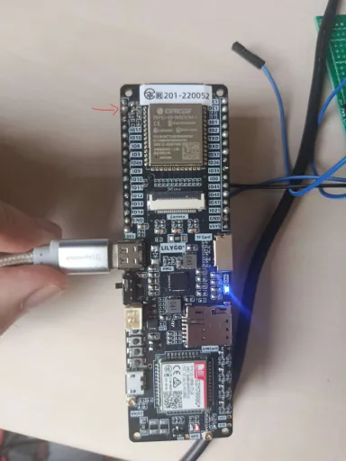
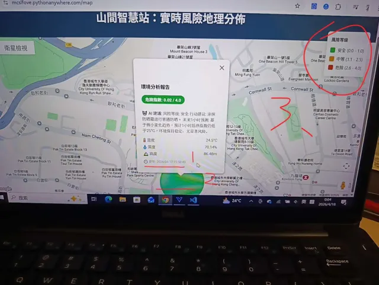

# T-SIM7080G 山間智慧環境監測站

基於 **LilyGo T-SIM7080G（ESP32-S3）** 的環境監測節點：讀取 BME280、LTR390UV、SHT4x 與 AXP2101 電源資訊，透過 **BLE** 與 **Wi-Fi HTTP** 輸出資料；配合 `tools/calling_api.py` 與 DeepSeek API，形成「感測 → 上傳 → AI 風險分析 → 地圖顯示」的完整 demo。




## 功能

- **BME280**：溫度、濕度、氣壓、海拔（I2C `0x76`）
- **LTR390UV**：紫外線 raw 值與 UV index（I2C `0x1C`）
- **SHT4x**：高精度溫度／濕度（I2C `0x44`，命令 `0xFD`）
- **AXP2101 PMU**：電池電壓、充電狀態、系統電壓與各電源軌控制
- **BLE notify**：每 2 秒推送遙測字串與電源狀態
- **Wi-Fi HTTP**：每 10 秒 POST JSON 到 `hikingtrailhk.net/update`
- **序列埠**：同步輸出資料，方便用 VOFA+ 或序列監看工具觀察
- **AI 分析**：`tools/calling_api.py` 取得最新資料、平滑與計算熱指數／綜合風險指標，呼叫 DeepSeek 產生建議，再上傳到地圖後端

## 系統架構

```text
BME280 / LTR390UV / SHT4x
          │ I2C（SDA 13 / SCL 21，100 kHz）
          ▼
   ESP32-S3（T-SIM7080G）
   ├── BLE notify ──────────────► 手機／BLE 客戶端
   ├── Serial 115200 ───────────► VOFA+ / 序列監看
   └── Wi-Fi HTTP POST /update ─► hikingtrailhk.net（SQLite）
                                        │
                         tools/calling_api.py（GET /api/latest）
                                        │ 平滑、熱指數、CRI
                                        ▼
                                DeepSeek API（deepseek-reasoner）
                                        │ AI 建議
                                        ▼
                           POST /post_analysis ─► /map 地圖 UI
```

> 後端 Flask／資料庫程式**不在這個 repo**。`src/esp_spare.cpp` 與 `src/spare2.cpp` 內保留了註解掉的 Flask、Google Maps 與熱力圖原型，只作參考，不會被編譯成功能。

## 硬體

| 項目 | 內容 |
| --- | --- |
| 開發板 | LilyGo T-SIM7080G（ESP32-S3 + SIM7080G） |
| 蜂窩模組 | SIM7080G（LTE／GNSS）；目前主程式未啟用，資料走 Wi-Fi |
| 電源管理 | AXP2101（I2C SDA 15 / SCL 7） |
| 感測器 I2C | SDA 13 / SCL 21，100 kHz |
| 顯示／互動 | BLE、序列埠 |
| 電源 | USB-C 或鋰電池（依板子設計） |

### I2C 裝置

| 裝置 | 位址 | 用途 |
| --- | --- | --- |
| BME280 | `0x76` | 溫度、濕度、氣壓、海拔 |
| LTR390UV | `0x1C` | UV raw／UV index |
| SHT4x | `0x44` | 溫度、濕度 |
| AXP2101 | — | PMU（獨立 I2C：SDA 15 / SCL 7） |

### BLE

| 項目 | 值 |
| --- | --- |
| 裝置名稱 | `Mountain_Station_S3` |
| Service UUID | `4fafc201-1fb5-459e-8fcc-c5c9c331914b` |
| Characteristic UUID | `beb5483e-36e1-4688-b7f5-ea07361b26a8` |
| 屬性 | Read + Notify |
| MTU | 512 |

韌體會用 notify 推送兩種字串：

- 感測器遙測：UV index、UV raw、電池百分比、BME280 溫度／氣壓／濕度／海拔、SHT4x 溫度／濕度。
- 電源狀態：充電／放電、電池電壓、VBUS 電壓、是否插入 VBUS。

實際字串格式見 `lib/Testing_ATDebug/datacollect_first.cpp` 的 `data_package()` 與 `data_package2()`。

## 目錄結構

```text
T-sim/
├── README.md
├── .gitignore
└── t-sim/                         # PlatformIO 專案根目錄
    ├── platformio.ini
    ├── src/
    │   ├── main.cpp               # 初始化與 2 秒主迴圈
    │   ├── esp_spare.cpp          # 註解掉的 Flask / Google Maps 原型
    │   └── spare2.cpp             # 註解掉的熱力圖原型
    ├── lib/
    │   ├── Testing_ATDebug/       # 本專案自訂模組（重點）
    │   │   ├── datacollect_first.* # 感測器、PMU、BLE、資料打包
    │   │   ├── wifi_send_py.*     # Wi-Fi 連線與 HTTP 上傳
    │   │   ├── camera.*           # LilyGo 相機範例（未啟用）
    │   │   ├── sdcard.*           # SD 卡範例（未啟用）
    │   │   ├── modem.*            # SIM7080G 範例（未啟用）
    │   │   ├── network.*          # Wi-Fi 範例
    │   │   ├── power.*            # AXP2101 範例
    │   │   ├── server.*           # HTTP server 範例（未啟用）
    │   │   └── utilities.h
    │   ├── LilyGo-T-SIM7080G-master/ # 原廠範例與函式庫（vendored）
    │   ├── DFRobot_LTR390UV-master/
    │   ├── DFRobot_RTU/
    │   └── sht4x-main/
    ├── tools/
    │   ├── calling_api.py         # 資料抓取 + AI 分析 + 上傳
    │   ├── Memory.md              # AI 系統提示（登山嚮導角色）
    │   └── Geography_facilities.md# 地理位置與設施描述
    ├── Image/
    │   ├── hardware.jpg
    │   └── Map_UI.jpg
    ├── include/                   # PlatformIO 預設
    ├── test/                      # PlatformIO 預設
    └── .gitignore                 # PlatformIO 預設
```

> `Testing_ATDebug` 雖然放在 `lib/`，但它是**本專案自己的程式碼**，不是第三方函式庫。

## 建置與燒錄

```bash
cd t-sim

# 建置
pio run

# 燒錄
pio run --target upload

# 序列埠監看（115200）
pio device monitor --baud 115200
```

`platformio.ini` 的環境名稱是 `t-sim7080g-s3`，也可以明確指定：

```bash
pio run -e t-sim7080g-s3
pio run -e t-sim7080g-s3 --target upload
pio device monitor -e t-sim7080g-s3 --baud 115200
```

### 設定重點

| 設定 | 值 | 說明 |
| --- | --- | --- |
| `platform` | `espressif32` | Espressif 32 平台 |
| `board` | `esp32s3box` | 以 ESP32-S3 板型編譯 |
| `framework` | `arduino` | Arduino-ESP32 |
| `board_build.partitions` | `huge_app.csv` | 單一大型應用分區 |
| `upload_port` / `monitor_port` | `COM7` | **請改成你電腦上的實際埠** |
| `lib_extra_dirs` | `lib/LilyGo-T-SIM7080G-master/lib` | 使用原廠隨附函式庫 |

從 `lib_deps` 自動安裝的函式庫：Adafruit BME280、Adafruit LTR390、SHT2x、Adafruit BusIO、Adafruit Unified Sensor、LTR390_DFR、ArduinoJson。

## 設定與參數

| 位置 | 內容 |
| --- | --- |
| `t-sim/platformio.ini` | 環境、板型、序列埠、分區表、`lib_deps` |
| `lib/Testing_ATDebug/datacollect_first.h` | I2C 腳位、BLE UUID、`UV_OPEN` / `ALS_OPEN` 開關、資料結構 |
| `lib/Testing_ATDebug/wifi_send_py.cpp` | Wi-Fi SSID／密碼、ThingSpeak Channel ID／API keys、伺服器 URL、上傳間隔（預設 10 秒） |
| `tools/calling_api.py` | DeepSeek API key、資料來源與分析上傳端點、平滑權重 |
| `tools/Memory.md` | 給 AI 的角色與風險評估規則 |
| `tools/Geography_facilities.md` | 給 AI 的周邊設施與路徑描述 |

### 上傳的 JSON 欄位

`wifi_send_py.cpp` 會 POST 到 `http://www.hikingtrailhk.net/update`，內容大致如下：

```json
{
  "api_key": "...",
  "Temp1": 24.5,
  "Humid1": 61.2,
  "Pressure": 1008.3,
  "Altitude": 32.1,
  "UV_raw": 1234,
  "Uv_index": 2.1,
  "Temp2": 24.7,
  "Humid2": 60.8
}
```

`Temp1` / `Humid1` / `Pressure` / `Altitude` 來自 BME280；`UV_raw` / `Uv_index` 來自 LTR390UV；`Temp2` / `Humid2` 來自 SHT4x。

## 主程式流程

1. `setup()`
   - 啟動序列埠（115200）與兩組 I2C。
   - `initSystemPower()`：配置 AXP2101 的 ALDO1／ALDO2／DC3 等電源軌，關閉未使用通道。
   - 初始化 LTR390UV、BME280、BLE、Wi-Fi。
2. `loop()`（每 2 秒）
   - `scanI2C()` 掃描感測器 I2C 匯流排（除錯用）。
   - 讀取 BME280 → LTR390UV → SHT4x。
   - 打包遙測字串與電源狀態字串。
   - 若 BLE 有客戶端連線，送出 notify；否則只印序列埠。
   - 每 10 秒呼叫 `http_sendData()` 上傳 JSON。
   - `delay(2000)`。

## 搭配工具

### `tools/calling_api.py`

流程：

1. `GET http://www.hikingtrailhk.net/api/latest` 取得最近 6 筆資料。
2. 反轉時間順序，對溫度、濕度、氣壓、海拔、UV 做加權平滑。
3. 計算熱指數（Heat Index）與綜合風險指標（CRI）。
4. 把平滑後資料、變化量與系統提示送到 DeepSeek `deepseek-reasoner`。
5. 把 AI 建議與座標 POST 到 `/post_analysis`，供 `/map` 顯示風險圓圈。

執行：

```bash
python -m venv .venv
.venv\Scripts\activate
pip install requests openai
python tools/calling_api.py
```

目前 `__main__` 會執行 10 次、每次間隔 10 秒，屬於 demo 寫法；長期運行請改成排程或常駐服務。

### 提示文件

- `Memory.md`：定義 AI 是「登山嚮導／山地救援專家」，包含熱壓力、UV、趨勢預測與輸出格式。
- `Geography_facilities.md`：描述香港都會大學賽馬會校園一帶的設施與海拔關係，讓 AI 的建議更貼近現場。

## 憑證設定（重要）

下列位置原本有明碼憑證，現在都已改成 `Your ...` 佔位符，執行前請填入自己的設定：

- `lib/Testing_ATDebug/wifi_send_py.cpp`：Wi-Fi SSID／密碼、ThingSpeak Channel ID、Write／Read API key、伺服器 API key。
- `tools/calling_api.py`：DeepSeek API key。
- `src/esp_spare.cpp`：註解中的 Flask 驗證用 key 與 Google Maps API key。

建議不要把真實值寫回原始碼，改用不納入版控的 `include/secrets.h` 或環境變數。若這些舊憑證曾經 commit 或推送過，單刪檔案不夠，請先撤銷／輪換金鑰，並用 `git filter-repo` 或 BFG 清理歷史。

## 已知限制

- `wifi_init()` 會一直等待 Wi-Fi 連線成功；沒有網路時裝置會卡在初始化，沒有離線降級或逾時。
- `BME280_init()` 失敗時會進入 `while (1)`，整台裝置停止；量產版本應改成重試或降級。
- `loop()` 每 2 秒執行一次 `scanI2C()`，這是除錯用途，會拖慢主迴圈；正式版可移除。
- `datacollect_first.h` 預設開啟 `UV_OPEN`；`ALS_OPEN` 模式目前未完成，請保持只開 UV。
- SIM7080G、相機、SD 卡、HTTP server 等範例模組有編譯，但 `main.cpp` 沒有啟用。
- HTTP 使用明文 `http://`，API key 放在 JSON body；正式部署應改 HTTPS 與伺服器端驗證。
- 上傳間隔 10 秒、主迴圈 2 秒是硬編碼常數；要調整請改 `wifi_send_py.cpp` 與 `main.cpp`。

## 版本控制說明

根目錄的 `.gitignore` 已排除：

- `.pio/` — PlatformIO 建置快取（此專案約 97 MB）
- `.history/` — VS Code Local History
- `.vscode/c_cpp_properties.json`、`.vscode/launch.json`、`.vscode/ipch/` — 由 PlatformIO 產生，含本機絕對路徑
- `sdkconfig`、`build/`、`*.bin`、`*.elf`、`*.map` — 建置產物
- `.env`、`secrets.h`、`*.pem`、`*.key` — 本機密鑰
- `__pycache__/`、`.venv/` — Python 快取與虛擬環境

`lib/` 內的原廠函式庫**會**納入版控，因為 `platformio.ini` 直接使用 `lib/LilyGo-T-SIM7080G-master/lib`。整個 `lib/` 約 74 MB，其中包含 datasheet、firmware 與範例；如果 repo 太大，可以只保留編譯需要的 `src/` 與 library 檔，或改用 Git submodule。

## 授權

本專案的自訂程式碼目前未附 `LICENSE`。`lib/` 內第三方函式庫（LilyGo、DFRobot、Sensirion SHT4x、XPowersLib、TinyGSM、ArduinoJson、PubSubClient 等）各自依原授權釋出，使用與再發布前請逐一確認。若要公開本專案，建議補上自己的授權條款，並保留第三方授權聲明。
